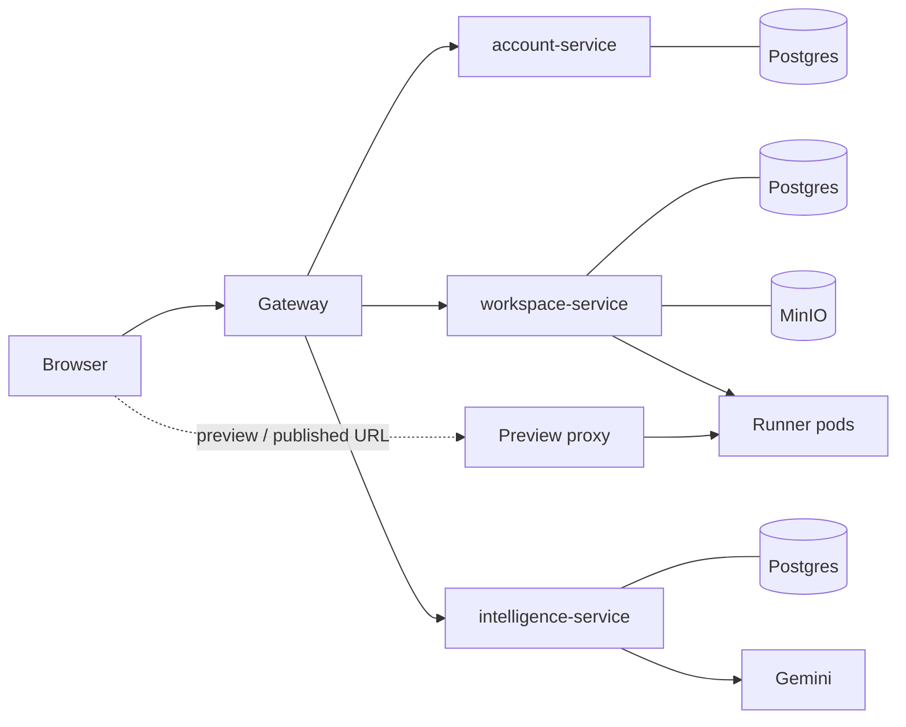
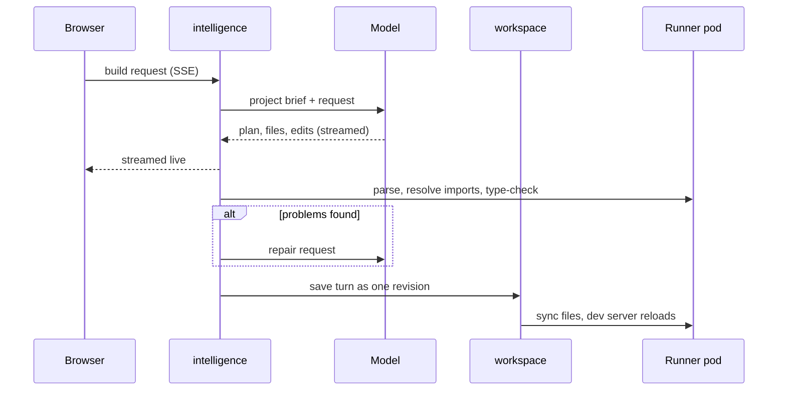

<p align="center">
  <a href="https://singularity.divyanshuagrahari.dev"></a>
</p>

<p align="center">
  <b>Describe an app, watch it get built, run it live, publish it.</b><br/>
  An AI app builder on Spring Boot microservices. Every generated app runs in its own Kubernetes pod.
</p>

<p align="center">
  <a href="https://github.com/Divyanshu2805/singularity/actions/workflows/ci.yml"></a>
  
  
  
  
  <a href="LICENSE"></a>
</p>

---

## Try it

| | |
|---|---|
| **App** | [singularity.divyanshuagrahari.dev](https://singularity.divyanshuagrahari.dev) |
| **Demo login** | `demo@singularity.dev` / `demo1234` |
| **Test card** | `4242 4242 4242 4242`, any future date, any CVC |

The demo account already has a notes app built, so you land straight in the chat, code and live preview. It's shared and resets every night, so it can't publish, invite, pay or connect GitHub. Sign in with Google or email to get your own account.

<p align="center">
  
</p>

## What it does

You describe an idea in one sentence. The model asks a few questions to pin it down, then builds the project file by file in a chat. The server checks every turn before saving it and sends broken code back to the model to fix. The app runs straight away in its own pod, and one click publishes it to a public link.

| | |
|---|---|
| **Build** | Idea interview, streaming builds with a checklist, edits as search-and-replace, undo and restore, an optional server + SQLite per project |
| **Run** | Live preview per project from a warm pod pool, shared with collaborators |
| **Share** | Publish to a public link, fork, owner/editor/viewer roles, ZIP export, push to GitHub |
| **Learn** | Teach me mode explains each step on the lines it changed, plus a project tour and glossary |
| **Billing** | Stripe plans with daily-token, project and preview limits |

## Results

| | Before | After |
|---|---|---|
| Model's first word on a build | 9.1 s | **2.7 s** (−70%) |
| A change to a built app | 21.3 s | **11.2 s** (−47%) |
| Preview start, fresh pod | 30.1 s | **4.3 s** (−86%) |
| Read throughput at 256 in flight, 300 users | 2,794 req/s | **3,429 req/s** (+23%) |
| p99 latency at the same load | 552 ms | **343 ms** (−38%) |
| Preview step in the browser E2E test | fails 1 in 10 | **30 / 30** |

On the build benchmark, 24 of 24 turns ended right, and all 20 generated projects install, type-check and bundle. Each full pass (interview, build, change, lesson) costs about 3 cents. How each number was measured: [docs/results.md](docs/results.md).

## How it works



| Service | Owns |
|---|---|
| Gateway | The only origin the browser talks to; routes by path |
| account | Users, sessions (Firebase → cookie), plans, Stripe |
| workspace | Projects, files, revisions, previews, publishing |
| intelligence | Build chat, lessons, idea interview, token usage |

Generated code never runs on a service. It only runs in runner pods: non-root, no capabilities, a strict network policy.



Each turn is saved as one revision: files are stored by SHA-256, and the project's head moves with a compare-and-swap, so a turn lands whole or not at all. Publishing builds in a separate pod and only flips a pointer once the build succeeds, so a failed build never breaks the live app.

More: [architecture](docs/architecture.md).

## Stack

| | |
|---|---|
| Backend | Java 25, Spring Boot 4.1, Spring Cloud Gateway, Eureka, OpenFeign, Spring AI |
| Data | PostgreSQL (one per service, Flyway), MinIO, Redis |
| Frontend | React 18, TypeScript, Vite, Tailwind, shadcn/ui, TanStack Query, CodeMirror |
| Infra | k3s, Kustomize, Cloudflare Tunnel, Tailscale, GitHub Actions, GHCR |
| Testing | JUnit, Testcontainers, Vitest, Playwright |

## Run it locally

No keys needed. This starts everything on a kind cluster with a scripted model and the Firebase emulator:

```bash
./mvnw -DskipTests package
e2e/stack.sh up --context kind-<your-cluster>
```

The full dev setup with your own keys is in [docs/development.md](docs/development.md).

## Tests

| Suite | Count |
|---|---|
| Backend (JUnit, Testcontainers) | 1,623 |
| Frontend (Vitest) | 931 |
| Preview proxy | 92 |
| Real preview + publish on kind | 17 steps |
| Browser journeys (Playwright) | 2 journeys, 24 steps |

CI runs all of it on every push to `main`, then builds 8 arm64 images, deploys after approval and rolls back if the smoke test fails.

## Docs

| | |
|---|---|
| [Architecture](docs/architecture.md) | Services, flows, revisions, security, key decisions |
| [API](docs/api.md) | Every endpoint |
| [Data model](docs/data-model.md) | Tables per service |
| [Development](docs/development.md) | Setup, config, commands, troubleshooting |
| [Deployment](docs/deployment.md) | Production on k3s, CI/CD, operations |
| [Results](docs/results.md) | Measurements and how they were taken |
| [Known gaps](docs/known-gaps.md) | What isn't built yet |

## License

[MIT](LICENSE)
