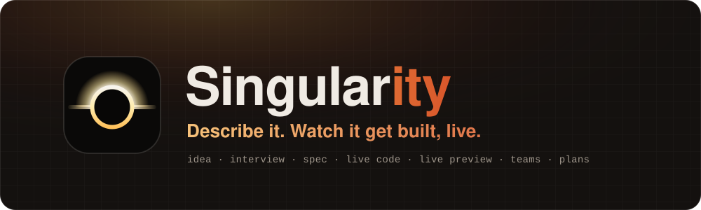
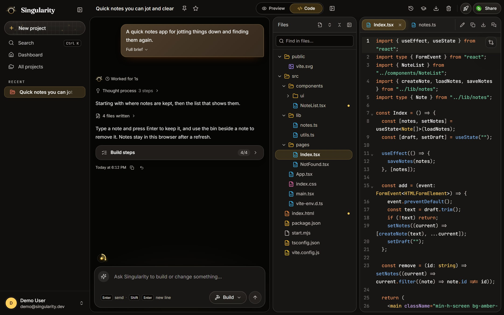
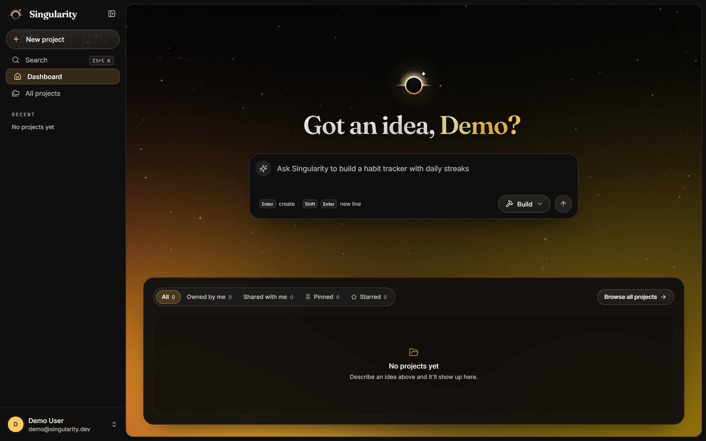
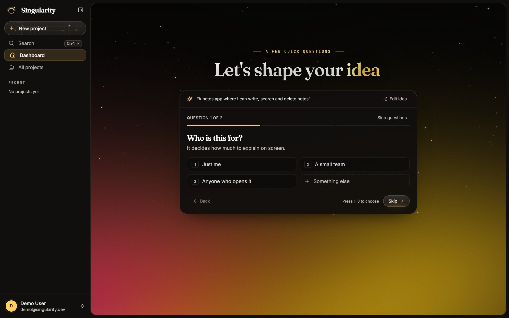
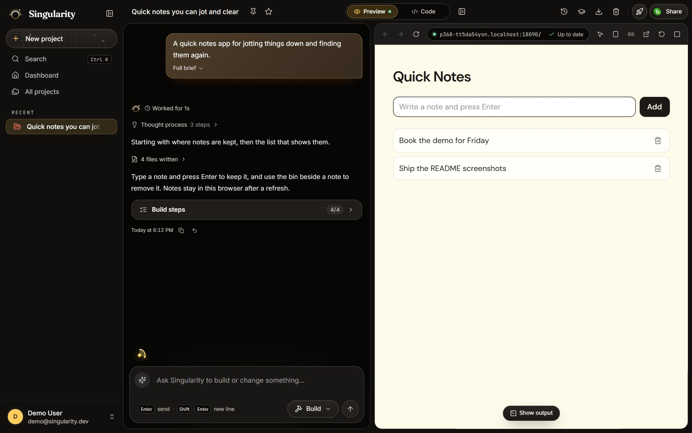
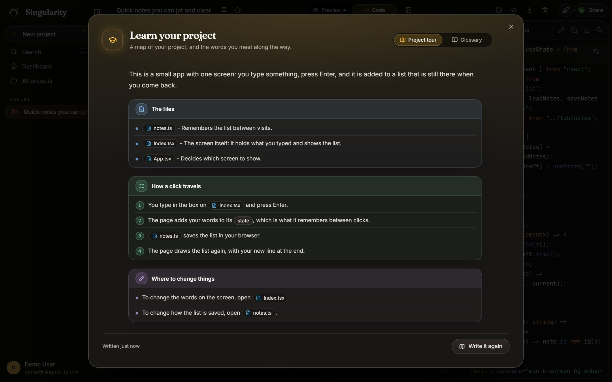
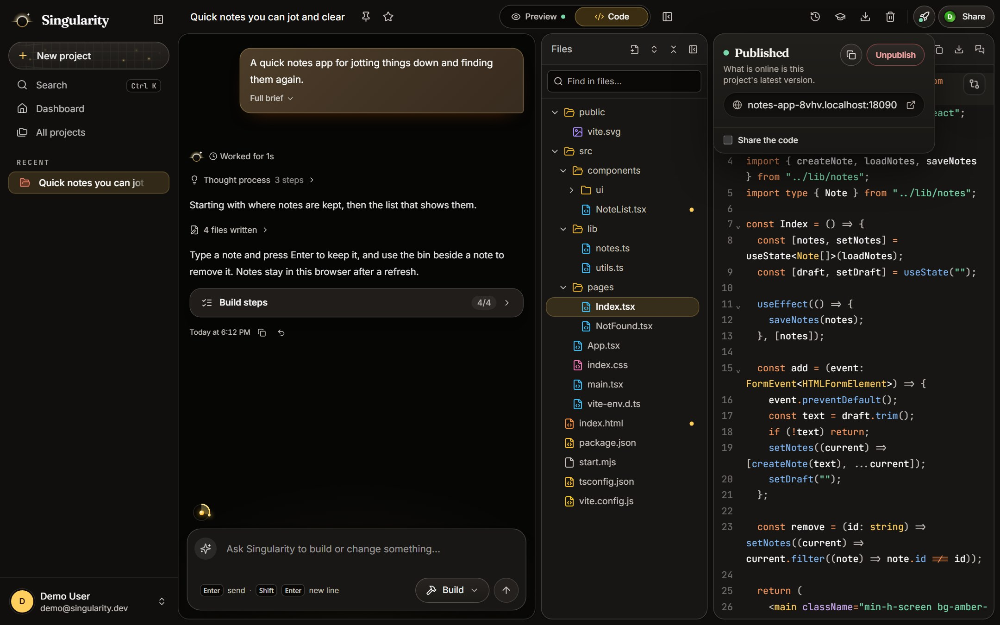
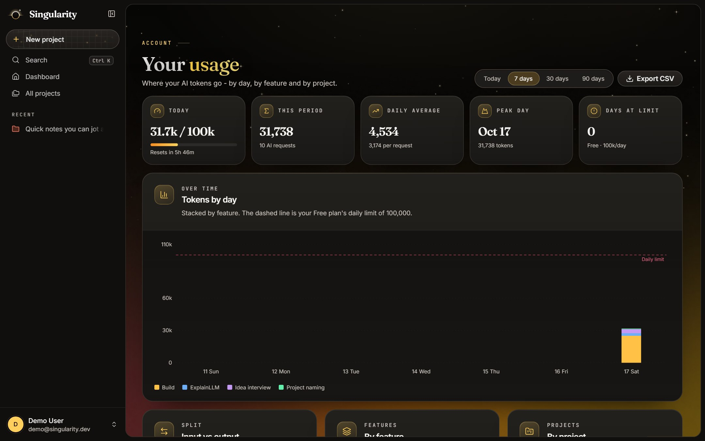
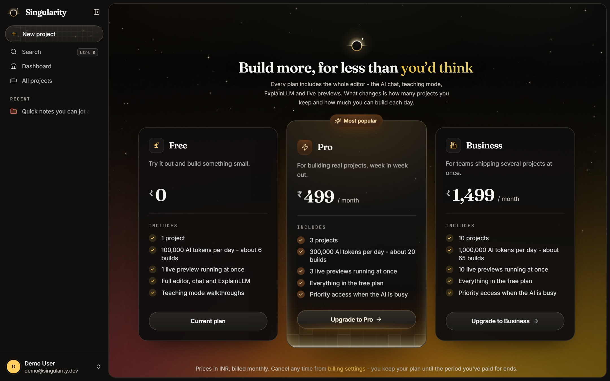
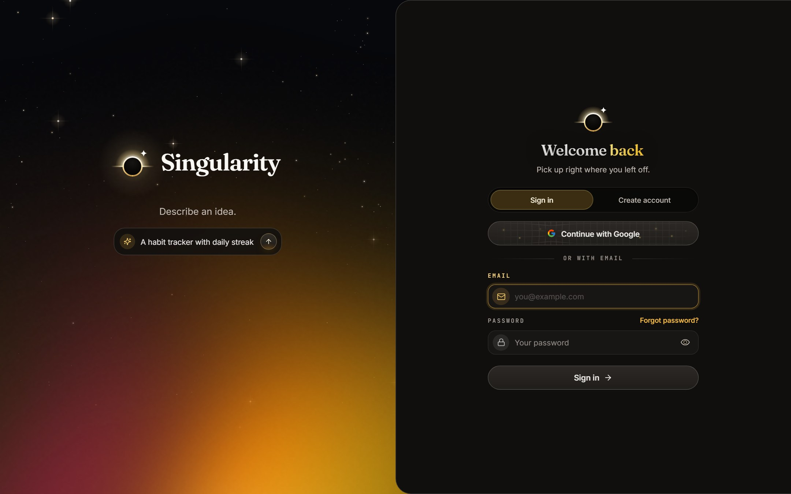

<p align="center">
  <a href="https://singularity.divyanshuagrahari.dev"></a>
</p>

<p align="center">
  <b>Describe an idea. Watch a real app get built, run and published - live.</b><br/>
  An AI project builder on Spring Boot microservices, with sandboxed Kubernetes previews and a teaching mode.
</p>

<p align="center">
  <a href="https://github.com/Divyanshu2805/singularity/actions/workflows/ci.yml"></a>
  
  
  
  
  
  
  
  
  
  
  
  
  
  
  
  <a href="LICENSE"></a>
</p>

<p align="center">
  <a href="https://singularity.divyanshuagrahari.dev"><b>singularity.divyanshuagrahari.dev</b></a>
</p>

---

You type a one-line idea. A short interview the model writes for that idea turns it into a brief; an AI chat then builds the project file by file while a checklist ticks off each step; every turn lands as one atomic revision; and the result runs in its own Kubernetes pod behind a signed preview link, updating as you keep asking for changes. When it's ready, one click publishes a production build at a public link. **Singularity** is that system: five Spring services, three databases, a preview pipeline on Kubernetes, and a teaching mode that explains every step of what was built in the reader's own code.

## Try it

| | |
|---|---|
| **Live app** | [singularity.divyanshuagrahari.dev](https://singularity.divyanshuagrahari.dev) |
| **Demo login** | `demo@singularity.dev` / `demo1234`. A shared, public account (Demo User) that opens on the notes app from the screenshots, already built with its chat, files and preview: it can't publish, connect GitHub, invite anyone, pay, change its sign-in security or delete itself, and it is put back every day |
| **Your own account** | Sign in with Google, or register with an email and verify it |
| **Paying** | Production runs Stripe in **test mode**: use card `4242 4242 4242 4242`, any future date and any CVC. No money moves |
| **Locally, with no keys** | `e2e/stack.sh up --context kind-<cluster>` starts the whole application with a scripted model and the Firebase Auth emulator; see [the browser journey](docs/practices/testing.md#the-browser-journey) |

## Screenshots

<p align="center">
  
</p>

| | |
|---|---|
|  |  |
| Start from one sentence | An interview written for that idea turns it into a brief |
|  |  |
| The app running in its own pod, updating with every turn | Learn your project: how a click travels through the files |
|  |  |
| One click publishes a production build at a public link | Metered usage against a daily token allowance |
|  |  |
| Plans billed through Stripe, with limits enforced on the server | Sign in with email, Google and optional two-step verification |

All screenshots are from the local stack (`e2e/stack.sh`) with the scripted model, so the built app is the same small notes app every time.

## Features

**Building**
- **Idea interview** - the model asks between zero and five questions written for the idea, then compiles the answers into a brief before any code is written
- **Streaming builds** in a tag-based protocol parsed on the server and again in the browser, held to one shared file of test cases so the two never disagree; an existing file is changed with search-and-replace edits, not rewritten
- **Checked before saving** - every written file is parsed, its imports resolved, and the turn type-checked in the project's own preview pod; anything broken goes back to the model as a repair, and only the errors the turn itself caused count
- **Atomic, content-addressed revisions** - every turn is one all-or-nothing revision; any earlier one can be restored, and a turn can be undone
- **A server and database per project** when the idea needs one: the preview runs it beside the dev server

**Running and sharing**
- **Live previews** - each project runs in its own pod from a warm pool, behind a signed, expiring link routed through Redis and a small Node proxy; collaborators share one preview, and idle pods are reclaimed
- **Publishing** - the owner publishes a production build, made in a pod claimed for it and served from object storage at a public link with strict headers; updates replace it atomically and unpublishing takes it down first
- **Collaboration** - owner, editor and viewer roles, invitations, forking, pinning and starring, code search, ZIP export and pushing to GitHub

**Learning**
- **Teach me mode** - every step of a build opens a lesson on the lines it changed, written for the reader's level, ending in a small exercise the model checks
- **Learn your project** - a tour of how a click travels through the files, and a glossary of every word a lesson marked, with examples from the reader's own code
- **Code insight** - ask about any selection or the whole project; answers are read-only by construction and kept as private notes

**Accounts and billing**
- **Sign-in** through Firebase (email and password or Google, with optional two-step verification), turned into a server-side session cookie; account deletion removes everything the account owns
- **Plans** on Stripe with enforced daily-token, project and preview limits, and a usage page by day, feature and project

## How a build flows

1. **Clarify.** intelligence-service turns the idea into questions, then a brief.
2. **Generate.** The brief opens a chat; the model streams its plan, files and edits in tags over SSE through the Gateway.
3. **Check.** Each file is parsed, its imports resolved and the turn type-checked in the project's preview pod; problems go back to the model.
4. **Save.** workspace-service publishes the turn's files to MinIO as one atomic revision.
5. **Preview.** A warm pod is claimed, the files are synced in and the Vite dev server runs there, reached through Redis and the preview proxy.
6. **Publish.** A production build is made in a pod claimed for it, taken out as a tar, stored, and served from storage at the app's own link.

## Architecture

A Spring Cloud Gateway is the browser's only origin and routes each path to one of three domain services - **account**, **workspace** and **intelligence** - each with its own PostgreSQL database. Services find each other through Eureka and call each other over a private `/internal` API that needs a shared-secret authority and is never routed from outside. Sign-in is Firebase; each service checks the session cookie itself. **Generated code runs only inside runner pods**, never on a service.

| Area | Choice |
|---|---|
| Services | Java 25 and Spring Boot 4.1; Spring Cloud 2025.1 (Gateway, Eureka, OpenFeign); Spring AI 2.0 against an OpenAI-compatible API |
| Data | PostgreSQL, one database per service, every schema owned by Flyway; MinIO for files, revisions and published apps; Redis for preview routes |
| Previews | fabric8 Kubernetes client claiming pods from a warm pool, exec and file upload; a Node reverse proxy with signed tokens |
| Frontend | React 18, TypeScript, Vite, Tailwind CSS and shadcn/ui, TanStack Query, CodeMirror |
| Delivery | Eight arm64 images on GHCR, Kustomize, single-node k3s behind a Cloudflare tunnel, GitHub Actions with automatic rollback |
| Quality | JUnit and Testcontainers, Vitest, Playwright, a real preview and a real publish on kind in CI, Lighthouse, CodeQL |

The decisions behind the shape, each with the alternatives it was chosen over:

| Decision | Why |
|---|---|
| [Microservices with a database each](docs/architecture/decisions/0001-microservices-with-database-per-service.md) | A service changes its schema or scales without touching the others |
| [Firebase identity, server sessions](docs/architecture/decisions/0002-firebase-identity-with-server-sessions.md) | No passwords stored here, and a session the server can revoke |
| [Generated code only in runner pods](docs/architecture/decisions/0003-run-generated-code-only-in-runner-pods.md) | Untrusted code never runs where the data is |
| [A tag-based generation protocol](docs/architecture/decisions/0004-tag-based-generation-protocol.md) | A stream that can be shown as it arrives and parsed the same way twice |
| [Content-addressed file revisions](docs/architecture/decisions/0005-content-addressed-file-revisions.md) | A turn's files land together or not at all, and history is cheap |
| [Flyway owns every schema](docs/architecture/decisions/0006-flyway-owned-schemas.md) | Every change is reviewed and repeatable |
| [Single-node k3s](docs/architecture/decisions/0007-single-node-k3s-deployment.md) | Real Kubernetes on one free VM |
| [Published apps from storage](docs/architecture/decisions/0008-published-apps.md) | A shared app needs no running pod |
| [A server in the preview](docs/architecture/decisions/0009-a-server-in-the-preview.md) | Apps that share data between people, still sandboxed |
| [Push a project to GitHub](docs/architecture/decisions/0010-push-a-project-to-github.md) | The code is the user's to take |

More in the [architecture overview](docs/architecture/README.md), the [request flows](docs/architecture/flows/) and the [tech stack](docs/tech-stack.md).

## Security

The rules are written down in the [security guardrails](docs/practices/security-guardrails.md) and the [security model](docs/architecture/security-model.md). In short:

- **Untrusted code is fenced:** generated code runs only in runner pods (non-root, capabilities dropped, a network policy, PID and resource limits), reached through the Kubernetes exec API; output from a build pod is read as data, links and odd entries refused.
- **One way in:** the Gateway is the only origin, `/internal/**` needs the internal-service authority in every filter chain, CSRF stays on for cookie sessions, and the one anonymous path is a `GET` under `/api/public/**`.
- **Least privilege for the model:** code insight gets one read-only tool, file text reaches a model only inside a fence it cannot close, and model output reaches the page only through a renderer that allows no raw HTML.
- **Tenancy:** every project path goes through one validator, permission guards sit where the caller is a user, and an invitation grants nothing until it is accepted.
- **Published apps** are served only from their build's prefix, by a path checked first, with strict headers and never a cookie.
- **Supply chain:** actions pinned by SHA, CodeQL, a read-only workflow token by default.

Found a problem? See [SECURITY.md](SECURITY.md).

## Quality

Every figure below, and how to measure it again, is on [the product's numbers](docs/practices/product-numbers.md).

| What | Measured |
|---|---|
| Tests | **1,602** backend (JUnit, one on real PostgreSQL and MinIO in containers), **921** frontend, **92** proxy, and two browser journeys of 17 and 7 steps against every real service |
| Coverage | backend **74.9%** of lines, frontend logic **77.4%**, each held to a floor in CI |
| Build quality | **23 of 23** benchmark requests ended right, and **19 of 19** built projects compile and start |
| Time to the first word | **9.1 s → 2.4 s** (-74%) by giving each kind of call its own reasoning effort |
| Preview start | **30.1 s → 4.3 s** (-86%) from a warm pool with pre-installed packages |
| Under load | 2,880 reads at 48 a second, **p99 44 ms**, none failed; eight builds at once all saved, with 1.1 s of pipeline overhead |
| Flakiness | the preview step went from failing **1 run in 10** to **30 of 30**, after three races were found in logs and fixed |
| Bundle | the project view's script **931 kB → 223 kB** (-76%) |
| Lighthouse | accessibility, best practices and SEO **100** on the public pages, with floors in CI |

## Quick start

Requires a JDK 25, Node 20+, Docker, a Firebase project and an API key for an OpenAI-compatible provider; a local kind cluster is needed only for live previews. See [prerequisites](docs/local-development/prerequisites.md).

```bash
git clone https://github.com/Divyanshu2805/singularity.git
cd singularity
docker compose -f services.docker-compose.yml up -d     # PostgreSQL and MinIO
cp .env.example .env                                    # fill in your keys
./mvnw clean package -DskipTests                        # mvnw.cmd on Windows
```

Then start the five services, one terminal each, and the frontend - the order, ports and settings are in [setup](docs/local-development/setup.md). To try it with no keys at all, run the [browser journey's stack](docs/practices/testing.md#the-browser-journey) instead.

### Commands

```bash
./mvnw verify                                   # every backend test, and each module's coverage floor
cd frontend && npm test                         # frontend tests
cd proxy && node --test                         # the preview proxy and the published-app server
e2e/stack.sh up --context kind-singularity && (cd e2e && npm test)   # the browser journey
```

The full list is in [commands](docs/local-development/commands.md).

## Repository layout

```
common-lib/             shared error model, session authentication, internal-API plumbing
discovery-service/      Eureka service registry (:8761)
gateway-service/        Spring Cloud Gateway - the browser's single origin (:8000)
account-service/        users, plans, subscriptions, Stripe, sessions (:8081)
workspace-service/      projects, members, files, revisions, previews, publishing (:8082)
intelligence-service/   AI generation, code insight, idea interview, usage (:8083)
frontend/               React single-page app
proxy/                  Node reverse proxy for preview hostnames and published apps
e2e/                    the browser journey (Playwright) and the stack it runs on
k8s/                    the local preview pipeline on kind
deploy/                 production Kubernetes manifests (Kustomize) and deploy scripts
docker/                 the shared service Dockerfile and the preview-runner image
docs/                   documentation
```

## Deployment

The live app runs on one free-tier Oracle Cloud Arm VM as single-node k3s, with no open inbound ports: visitors arrive through a Cloudflare tunnel, deploys over Tailscale. GitHub Actions tests every change - including a real preview and a real publish on kind and both browser journeys - builds eight arm64 images, deploys them, smoke-tests the site and rolls back automatically on failure. A nightly job backs up the databases and object storage to Cloudflare R2.

See [deployment](docs/deployment/README.md) and [operations](docs/operations/README.md).

## Documentation

Everything lives in [`docs/`](docs/README.md):

| Section | Covers |
|---|---|
| [Local development](docs/local-development/README.md) | Setup, configuration, live previews, troubleshooting |
| [Architecture](docs/architecture/README.md) | Services, request flows, security model, decision records |
| [API reference](docs/api/README.md) | Every endpoint, streaming formats, errors |
| [Data model](docs/schema/README.md) | Databases, entities, schema conventions |
| [Engineering practices](docs/practices/README.md) | Conventions, guardrails, testing, known pitfalls, measured numbers |
| [Known gaps](docs/known-gaps/README.md) | Trade-offs and what isn't built yet |
| [Deployment](docs/deployment/README.md) · [Operations](docs/operations/README.md) | Running it in production |
| [Security](SECURITY.md) | Reporting a vulnerability |

## License

Released under the [MIT License](LICENSE).
