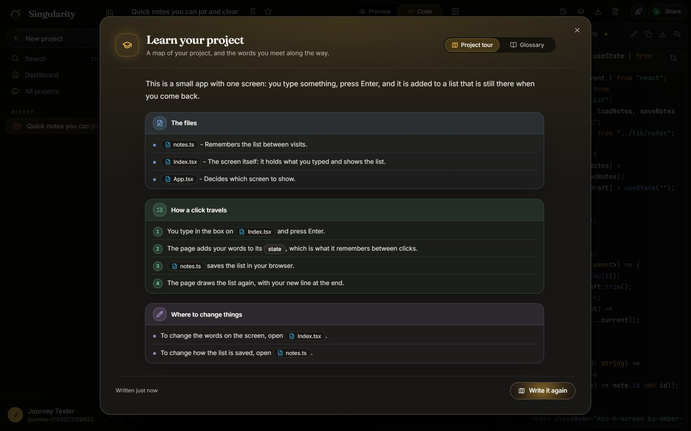
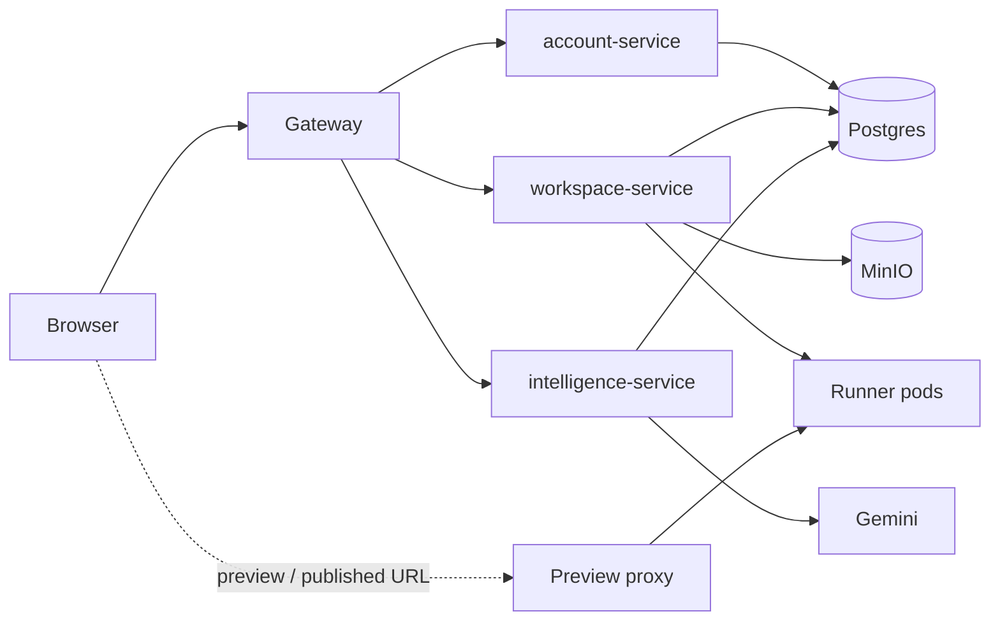
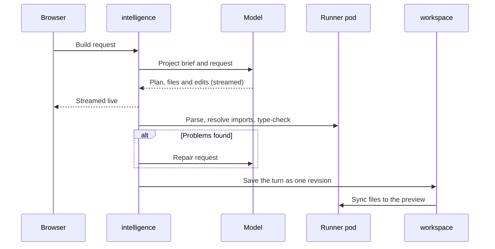

<p align="center">
  <a href="https://singularity.divyanshuagrahari.dev"></a>
</p>

<p align="center">
  <b>Describe an app, watch it get built, run it live, publish it.</b><br/>
  An AI app builder on Spring Boot microservices. Every generated app runs in its own Kubernetes pod.
</p>

<p align="center">
  <a href="https://github.com/Divyanshu2805/singularity/actions/workflows/ci.yml"></a>
  
  
  
  
  <a href="LICENSE"></a>
</p>

---

## Try it

| | |
|---|---|
| **App** | [singularity.divyanshuagrahari.dev](https://singularity.divyanshuagrahari.dev) |
| **Demo login** | `demo@singularity.dev` / `demo1234` |
| **Test card** | `4242 4242 4242 4242`, any future date, any CVC |

The demo account already has a notes app built, so you land straight in the chat, code and live preview. It's shared and resets every night, so it can't publish, invite, pay or connect GitHub. Sign in with Google or email to get your own account.

<p align="center">
  
</p>

## Features

**Building**
- Start from one sentence. The model asks a few questions written for your idea and turns the answers into a brief.
- The build streams live with a checklist of steps, the files being written, and the model's plan.
- Every turn is checked before it's saved: edits must apply, files must parse, imports must resolve, and the project must type-check. Anything broken goes back to the model to fix.
- Each turn is saved as one revision. You can undo it or restore any earlier version.
- If the app needs to share data between people, the model gives it its own Node server and SQLite database.
- Stop a build halfway, ask a question instead of building, or edit files by hand.

**Running and sharing**
- A live preview of every project, in its own pod, updating as files change.
- Collaborators with owner, editor and viewer roles. Invite someone by their email address, and everyone shares one preview.
- Publish a production build to a public link, with a share page that can show the code.
- Fork projects, export a ZIP, or push to a GitHub repository.

**Learning**
- Teach me mode explains each step of a build using the lines it changed, then sets a small exercise and checks your answer.
- A project tour shows how a click travels through the files.
- A glossary of every term a lesson marked, with examples from your own code.
- Select any code and ask about it. Answers can be saved as notes.

**Accounts and billing**
- Email, Google and optional two-step sign-in through Firebase, turned into a server-side session.
- Free, Pro and Business plans on Stripe, with daily token, project and preview limits enforced on the server.
- A usage page that breaks down tokens by day, feature and project.

## Screenshots

| | |
|---|---|
|  |  |
| Idea interview | Live preview |
|  |  |
| Project tour | Publishing |

## How it works



| Service | Owns |
|---|---|
| Gateway | The only origin the browser talks to. Routes by path |
| account | Users, sessions, plans, Stripe |
| workspace | Projects, files, revisions, previews, publishing |
| intelligence | Build chat, lessons, idea interview, token usage |

Each service has its own database. Generated code never runs on a service, only inside runner pods that are locked down: non-root, no Linux capabilities, a strict network policy.



A turn's files are stored by SHA-256, and the project's head moves with a compare-and-swap, so a turn lands whole or not at all. Publishing builds in a separate pod and switches the live app only after the build succeeds.

More detail in [docs/architecture.md](docs/architecture.md).

## Engineering highlights

- **Faster builds.** Dropping the model's reasoning effort and removing an extra file-fetch round trip cut the wait for the first word from 9.1 s to 2.7 s, and a change to an app from 21.3 s to 11.2 s.
- **Faster previews.** Keeping a warm pod with packages already installed cut a preview start from 30.1 s to 4.3 s.
- **Holds up under load.** A load test with 300 users found three limits through thread dumps: Feign without a connection pool, a DB connection held during storage reads, and a MinIO client capped at 5 calls. Fixing them raised throughput from 2,794 to 3,429 req/s and cut p99 latency from 552 ms to 343 ms at 256 concurrent requests.
- **Reliable generated code.** On a benchmark of 24 build requests, every turn ended correctly, and all 20 generated projects install, type-check and bundle.
- **No flaky preview test.** A preview race that failed 1 run in 10 was traced through pod logs to three causes, and after fixing them it passed 30 runs out of 30.

How each number was measured: [docs/results.md](docs/results.md).

## Stack

| | |
|---|---|
| Backend | Java 25, Spring Boot 4.1, Spring Cloud Gateway, Eureka, OpenFeign, Spring AI |
| Data | PostgreSQL (one database per service, Flyway), MinIO, Redis |
| Frontend | React 18, TypeScript, Vite, Tailwind, shadcn/ui, TanStack Query, CodeMirror |
| Infra | k3s on an Oracle Arm VM, Kustomize, Cloudflare Tunnel, Tailscale, GitHub Actions |
| Testing | JUnit, Testcontainers, Vitest, Playwright |
| Services | Firebase Auth, Stripe, Gemini |

## Running locally

The quickest way needs no keys. It starts the whole app on a kind cluster with a scripted model and the Firebase emulator:

```bash
./mvnw -DskipTests package
e2e/stack.sh up --context kind-<your-cluster>
```

Setting it up with your own keys is covered in [docs/development.md](docs/development.md).

## Testing and CI

| Suite | |
|---|---|
| Backend | 1,623 tests (JUnit, Testcontainers) |
| Frontend | 931 tests (Vitest) |
| Preview proxy | 92 tests |
| Real cluster | A preview and a publish on kind, end to end |
| Browser | Two Playwright journeys against every real service |

Every push to `main` runs all of it, builds 8 arm64 images, deploys after approval and rolls back automatically if the smoke test fails. Production is one free Oracle VM running k3s, with no open inbound ports: traffic comes through a Cloudflare tunnel. See [docs/deployment.md](docs/deployment.md).

## Docs

| | |
|---|---|
| [Architecture](docs/architecture.md) | Services, flows, revisions, previews, publishing, security |
| [API](docs/api.md) | Endpoints, errors, the chat stream |
| [Data model](docs/data-model.md) | Tables per service |
| [Development](docs/development.md) | Setup, config, tests, troubleshooting |
| [Deployment](docs/deployment.md) | Production, CI/CD, operations |
| [Results](docs/results.md) | How the numbers were measured |

## License

[MIT](LICENSE)
