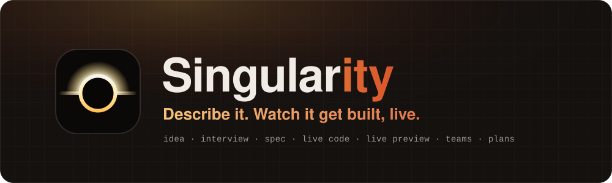
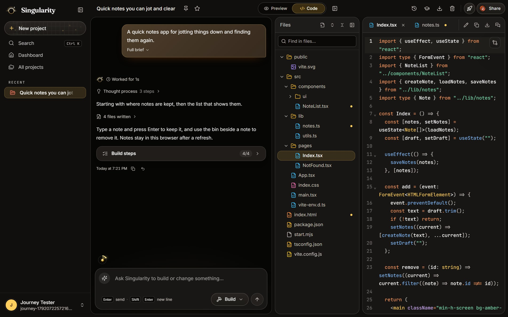
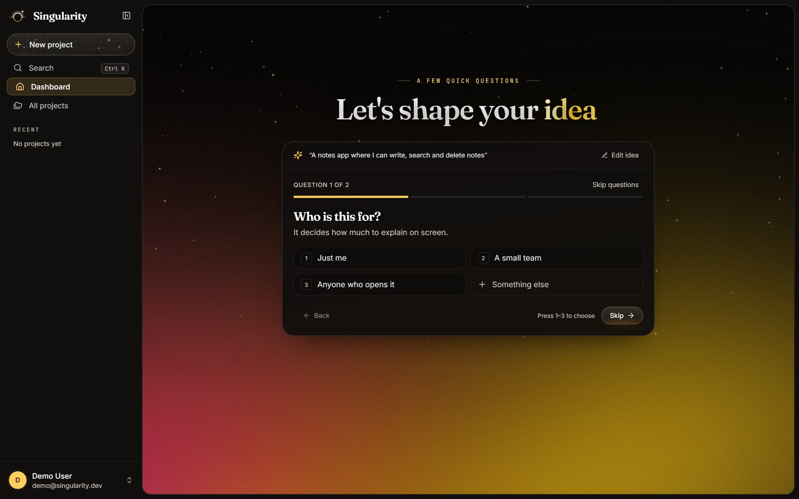
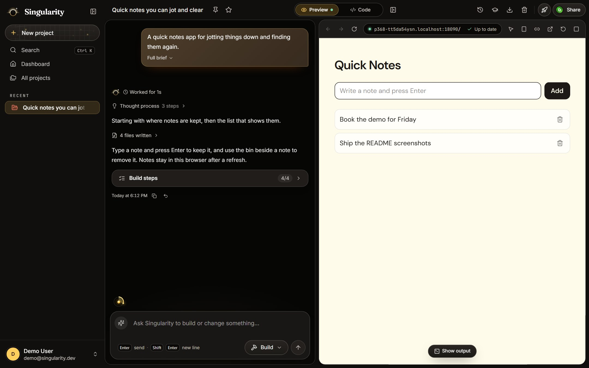
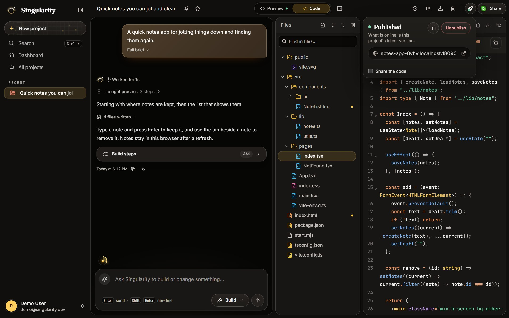

<p align="center">
  <a href="https://singularity.divyanshuagrahari.dev"></a>
</p>

<p align="center">
  <b>Describe an app, watch it get built, run it live, publish it.</b><br/>
  An AI app builder on Spring Boot microservices, with every generated app running in its own Kubernetes pod.
</p>

<p align="center">
  <a href="https://github.com/Divyanshu2805/singularity/actions/workflows/ci.yml"></a>
  
  
  
  
  <a href="LICENSE"></a>
</p>

<p align="center">
  <a href="https://singularity.divyanshuagrahari.dev"><b>Live demo</b></a> ·
  <a href="docs/README.md">Docs</a> ·
  <a href="docs/results.md">Results</a>
</p>

---

You type an idea in a sentence. A short interview, written for that idea, turns it into a brief. Then a chat builds the project file by file while you watch. The server checks every turn before saving it and sends anything broken back to the model to fix. Each turn is saved as one atomic revision, and the app runs straight away in its own pod behind a signed link. When it's ready, one click publishes a production build at a public URL.

It also teaches. Teach me mode explains each step on the lines it changed, and a project tour shows how a click travels through the files.

<p align="center">
  
</p>

## Try it

**[singularity.divyanshuagrahari.dev](https://singularity.divyanshuagrahari.dev)**. Sign in with Google or email, or use the shared demo account:

```
demo@singularity.dev / demo1234
```

The demo account opens on a notes app that's already built. It can't publish, connect GitHub, invite people or pay, and it's reset every night. Payments run in Stripe test mode, so `4242 4242 4242 4242` with any future date works and no money moves.

## Results

Measured on one development laptop. Setup, dates and the full tables are in [docs/results.md](docs/results.md).

| | |
|---|---|
| Time to the model's first word on a build | **9.1 s → 2.7 s** (−70%) from per-call reasoning effort |
| A change to a built app | **21.3 s → 11.2 s** (−47%) by dropping a file-fetch round trip |
| Preview first start, fresh pod | **30.1 s → 4.3 s** (−86%) from warm pods with pre-installed packages |
| Build benchmark | **24 / 24** turns right, **20 / 20** generated projects compile, **3 / 3** generated servers start |
| Read throughput | **2,794 → 3,429 req/s** (+23%) and **p99 552 → 343 ms** (−38%) at 256 in flight with 300 users, after thread dumps exposed connection-pool and storage-client limits |
| Reads at normal load | **p99 44 ms**, 0 of 2,880 failed (8 users, every call through the Gateway with its session checked) |
| Flaky preview step | **1 in 10 → 30 / 30** after three races were traced in pod logs |
| Cost | about **3 cents** for a whole pass: interview, build, change, lesson |
| Tests | **1,623** backend, **931** frontend, **92** proxy, plus a real preview and publish on kind and two Playwright journeys |
| Coverage | **75.4%** backend lines, **77.4%** frontend logic, each with a floor CI enforces |

## How it works

```
browser ──► Gateway ──┬──► account-service       users, sessions, plans, Stripe
                      ├──► workspace-service     projects, files, revisions, previews, publishing
                      └──► intelligence-service  build chat, lessons, idea interview, usage

  each service has its own Postgres · files in MinIO · services find each other via Eureka

preview hostnames ──► Node proxy ──► runner pods (generated code runs only here)
```

A build goes through six steps:

1. **Interview.** The model asks up to five questions written for the idea, then writes a brief.
2. **Generate.** The model streams its plan, files and edits in a tagged format over SSE. The server and the browser both parse it, against one shared file of test cases.
3. **Check.** Each file is parsed, its imports are resolved, and the turn is type-checked inside the project's preview pod. Problems go back to the model as a repair, and only errors the turn itself caused count.
4. **Save.** The turn's files are stored by SHA-256 and committed as one revision with a compare-and-swap on the project's head. It lands whole or not at all, and any revision can be restored.
5. **Preview.** A warm pod is claimed from a pool, the files sync in, and the Vite dev server runs there behind a signed, expiring link routed through Redis.
6. **Publish.** A production build runs in a pod claimed just for it. The output is read back as untrusted data and stored, and only then does a one-file pointer flip it live. A failed build never touches the live app.

The [architecture docs](docs/architecture/README.md) go further, and the [decision records](docs/architecture/decisions/README.md) cover why it's split this way, why generated code only runs in pods, and why revisions are content-addressed.

## Features

- **Building**: idea interview, streaming builds with a live checklist, search-and-replace edits, in-turn checks and repairs, undo and restore, and an optional server and SQLite database per project
- **Running**: a live preview per project from a warm pod pool, shared by collaborators and reclaimed when idle
- **Sharing**: publish to a public link, fork, owner/editor/viewer roles, invitations, ZIP export, push to GitHub
- **Learning**: Teach me mode with a lesson and a small exercise per step, a project tour, a glossary, and questions about any selection
- **Accounts**: Firebase sign-in turned into a server-side session, Stripe plans with daily-token, project and preview limits, and a usage page

## Screenshots

| | |
|---|---|
|  |  |
| The interview turns one sentence into a brief | The app running in its own pod |
|  |  |
| The project tour | One click to a public link |

The screenshots are from the local stack with the scripted model, so the app is the same small notes app every time.

## Stack

| | |
|---|---|
| Backend | Java 25, Spring Boot 4.1, Spring Cloud Gateway, Eureka, OpenFeign, Spring AI 2.0 |
| Data | PostgreSQL (one per service, Flyway), MinIO, Redis |
| Frontend | React 18, TypeScript, Vite, Tailwind, shadcn/ui, TanStack Query, CodeMirror |
| Previews | fabric8 Kubernetes client, a Node reverse proxy with signed tokens |
| Infra | k3s on an Oracle Arm VM, Kustomize, Cloudflare Tunnel, Tailscale, GitHub Actions, GHCR |
| Testing | JUnit, Testcontainers, Vitest, Playwright, Lighthouse |
| Integrations | Firebase Auth, Stripe, Gemini through an OpenAI-compatible API |

## Running it locally

The fastest way needs no keys at all. It starts the whole app on a kind cluster with a scripted model and the Firebase Auth emulator:

```bash
./mvnw -DskipTests package
e2e/stack.sh up --context kind-<your-cluster>
```

For a normal dev setup you need JDK 25, Node 20+, Docker, a Firebase project and a model API key:

```bash
git clone https://github.com/Divyanshu2805/singularity.git && cd singularity
docker compose -f services.docker-compose.yml up -d   # Postgres and MinIO
cp .env.example .env                                  # fill in your keys
./mvnw clean package -DskipTests                      # mvnw.cmd on Windows
```

Then start the five services and the frontend, as described in [setup](docs/local-development/setup.md). Live previews also need a local kind cluster ([live previews](docs/local-development/live-previews.md)).

```bash
./mvnw verify                          # backend tests and coverage floors
cd frontend && npm test                # frontend
cd proxy && node --test                # preview proxy
```

## Deployment

It runs on one free Oracle Arm VM as single-node k3s, with no inbound ports open. Traffic comes through a Cloudflare tunnel, and deploys go over Tailscale. On every push to `main`, CI runs the tests, a real preview and publish on kind, and both browser journeys. It then builds eight arm64 images, deploys after approval, smoke-tests the site and rolls back on failure. Databases and storage are backed up nightly to Cloudflare R2. See [deployment](docs/deployment/README.md).

## Repository layout

```
gateway-service/        Spring Cloud Gateway, the only origin the browser talks to
discovery-service/      Eureka
account-service/        users, sessions, plans, Stripe
workspace-service/      projects, files, revisions, previews, publishing
intelligence-service/   build chat, code insight, idea interview, usage
common-lib/             shared errors, session auth, internal-API plumbing
frontend/               React app
proxy/                  preview and published-app proxy (Node)
e2e/                    Playwright journeys, load test, local full stack
deploy/  k8s/  docker/  production manifests, local kind setup, Dockerfiles
docs/                   documentation
```

## License

[MIT](LICENSE)
