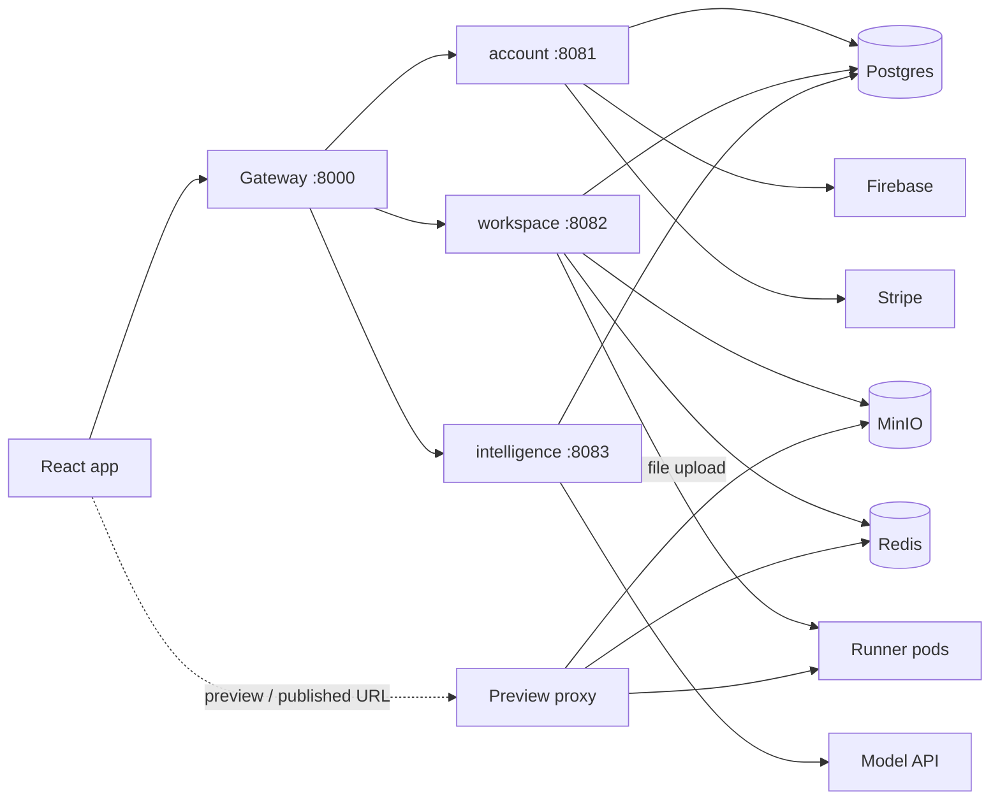
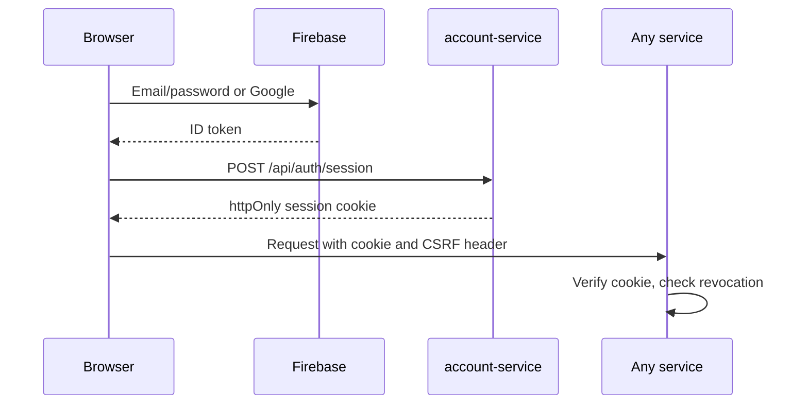
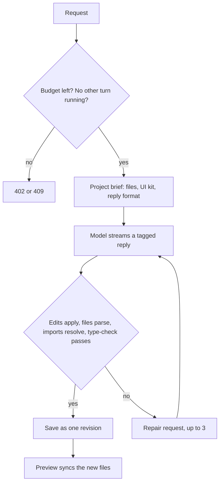
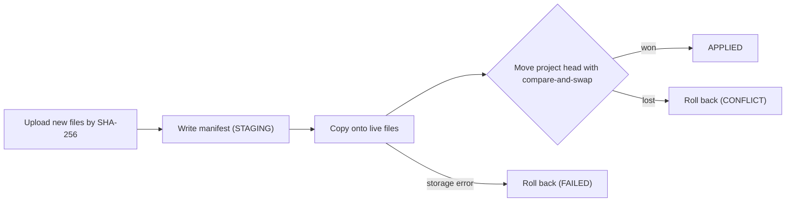
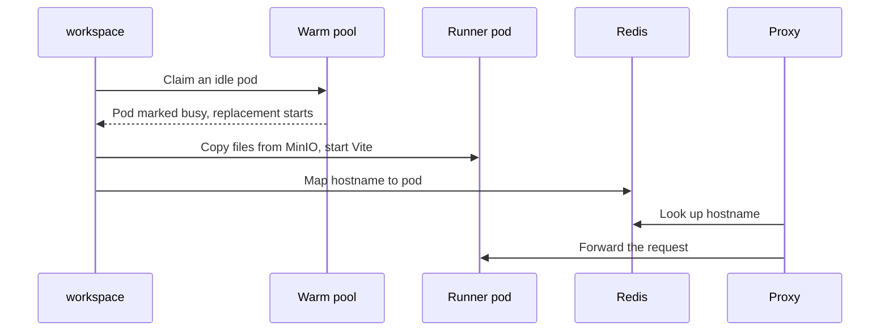
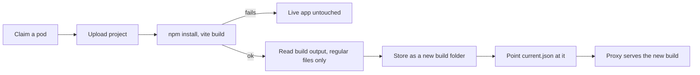

# Architecture

## Overview

| Service | Owns | Routes |
|---|---|---|
| gateway | Routing by path. No auth logic | everything below |
| discovery | Eureka registry | — |
| account | Users, sessions, plans, subscriptions, Stripe | `/api/auth`, `/api/plans`, `/api/me`, `/api/payments`, `/webhooks/payment` |
| workspace | Projects, members, files, revisions, previews, publishing, GitHub push | `/api/projects` (except `/code`), `/api/previews`, `/api/public`, `/api/github` |
| intelligence | Build chat, code insight and lessons, idea interview, usage | `/api/chat`, `/api/ideas`, `/api/usage`, `/api/projects/{id}/code` |
| common-lib | Error model, session auth, internal-call plumbing | — |
| proxy (Node) | Preview hostnames to runner pods, published apps from MinIO | `*.divyanshuagrahari.dev` |

Each service has its own database (three databases on one Postgres server) and never reads another's tables. When it needs data from another service, it calls that service's `/internal/v1` API over Feign with a shared secret. The Gateway never routes `/internal/**`.

## Sign-in

Passwords never reach the backend. Sessions can be revoked on the server, and signing out evicts them from every service's cache.

## Build turn

- The server owns the turn. If the browser disconnects, the turn keeps going, and the browser can rejoin it.
- The model replies in a small tag format: `<message>`, `<file>`, `<edit>`, `<delete>` and a few more. The server and the browser parse it the same way, and both run against one shared file of test cases.
- An existing file is changed with search/replace edits, so the untouched lines can't get damaged.
- The type-check runs inside the project's preview pod. Only errors the turn itself introduced go back to the model.
- Every wait has a limit: 3 min of silence, 10 min per call, 20 min per turn.
- Builds use `gemini-3.8-flash` at low reasoning effort. Lessons, the interview and short calls use `gemini-3.5-flash-lite`.

## Revisions

Every AI turn, restore and undo becomes one immutable revision. The project at any point in its history is rebuilt by walking parent links in one recursive query. Restore and undo publish a new revision, so history only moves forward.

## Live preview

- Warm pods already have `node_modules`, copied in by an init container. That's why a start takes about 4 s instead of 30.
- A claim is a patch on the pod with its `resourceVersion`, so two starts can never grab the same pod.
- A pod is never reused. Releasing it deletes it.
- Preview links carry a signed token that expires.
- A reaper stops previews idle for 10 min, fails stuck starts and cleans up orphaned pods.
- If the project has its own server, it runs in the same pod next to the dev server.

## Publishing

Only the owner can publish. The pointer is written last, so a failed build never touches what's live. Unpublishing deletes the pointer first. Published pages get a strict CSP and never set cookies.

## Security

| Area | How it's handled |
|---|---|
| Generated code | Runs only in runner pods: non-root, all capabilities dropped, seccomp on, no service-account token, CPU/memory/PID limits. Network is limited to DNS, MinIO and public HTTPS |
| Internal API | `/internal/**` needs the internal-service authority. A signed-in user's cookie isn't enough |
| Sessions | httpOnly `__Host-` cookie, CSRF on every write, server-side revocation |
| Projects | Per-project roles, checked on the browser-facing controller. Every file path goes through one validator |
| Model output | Rendered as Markdown with no raw HTML. File text shown to the model is fenced so a file can't break out of it |
| Code insight | One read-only tool |
| Build output | Treated as data: links refused, names checked, size and count limits |

## Design decisions

| Decision | Reason |
|---|---|
| Microservices, one database each | Schemas and scaling stay independent. It started as a monolith and was split later |
| Firebase identity with server sessions | No passwords stored here, and sessions the server can revoke |
| Generated code only in pods | Untrusted code never runs next to the data |
| Tag-based reply format | Can be shown while streaming and parsed the same way on both sides |
| Content-addressed revisions | A turn lands whole or not at all, and history is cheap |
| Flyway owns the schema | Hibernate only validates. Enum columns have no `CHECK` constraint |
| Single-node k3s | Real Kubernetes on one free VM, and the manifests move anywhere |
| Published apps served from storage | A shared app doesn't need a running pod |
