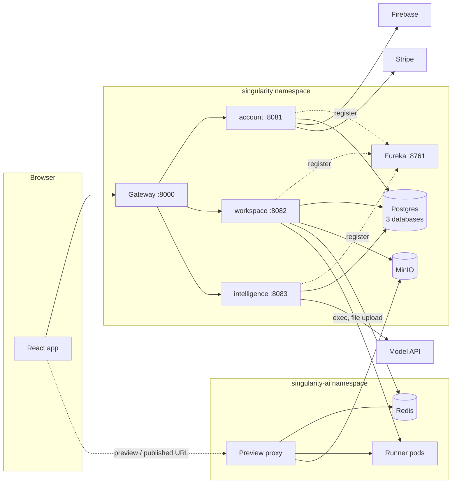
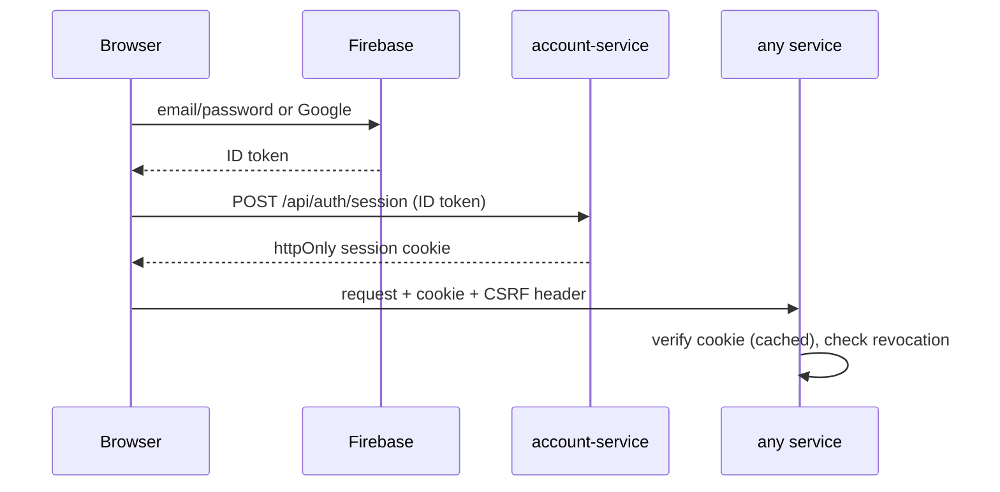
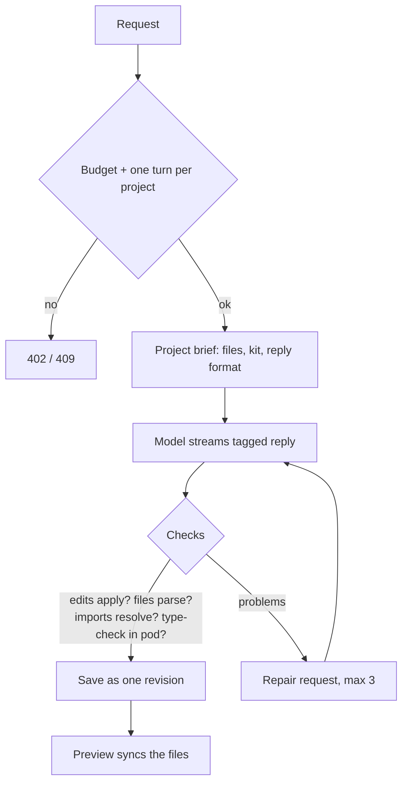
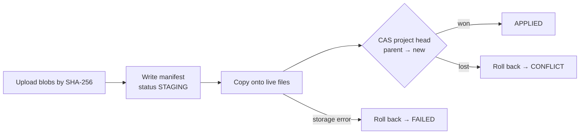
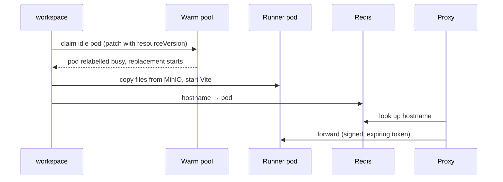
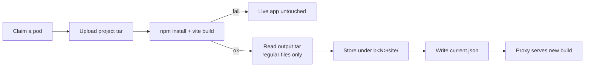

# Architecture

## Overview

| Service | Owns | Routes |
|---|---|---|
| gateway | Path-based routing, no auth logic | everything below |
| account | Users, sessions, plans, subscriptions, Stripe | `/api/auth`, `/api/plans`, `/api/me`, `/api/payments`, `/webhooks/payment` |
| workspace | Projects, members, files, revisions, previews, publishing, GitHub push | `/api/projects` (except `/code`), `/api/previews`, `/api/public`, `/api/github` |
| intelligence | Build chat, code insight and lessons, idea interview, usage | `/api/chat`, `/api/ideas`, `/api/usage`, `/api/projects/{id}/code` |
| common-lib | Error model, session auth, internal-call plumbing | — |
| proxy (Node) | Preview hostnames → runner pods, published apps → MinIO | `*.divyanshuagrahari.dev` |

Each service has its own database and never reads another's tables. When one needs another service's data, it calls that service's `/internal/v1` API through Feign, with a shared secret. The Gateway never routes `/internal/**`.

## Sign-in

No password reaches the backend. Sessions can be revoked server-side, and sign-out evicts them from every service's cache.

## A build turn

- The server owns the turn. If the browser disconnects, the turn carries on, and the browser can rejoin it.
- The reply uses a small tag format (`<message>`, `<file>`, `<edit>`, `<delete>`...). The server and the browser parse it the same way, and both are tested against one shared file of cases.
- An existing file is changed with search/replace edits, never rewritten whole.
- Only errors the turn itself introduced are sent back as repairs.
- Every wait has a limit: 3 min of silence, 10 min per call, 20 min per turn.
- Builds and repairs use `gemini-3.8-flash` at low reasoning effort. Everything else uses `gemini-3.5-flash-lite`.

## Revisions

Every AI turn, restore and undo publishes one immutable revision. A snapshot at any revision is rebuilt by walking parent links in a recursive query. Restore and undo work by publishing a new revision, so history only moves forward.

## Live preview

- Warm pods already have `node_modules`, copied in by an init container, which is why a start takes about 4 s instead of 30.
- A pod is never reused. Releasing it deletes it.
- A reaper stops idle previews after 10 min, fails stuck starts and deletes orphaned pods.
- A project's optional server runs in the same pod as the dev server.

## Publishing

Only the owner can publish. Unpublishing deletes `current.json` first, before touching the database row. Published pages carry a strict CSP and never set cookies.

## Security

| Boundary | How |
|---|---|
| Untrusted code | Runs only in runner pods: non-root, all capabilities dropped, seccomp, no service-account token, CPU/memory/PID limits, egress limited to DNS, MinIO and public 80/443 |
| Internal API | `/internal/**` needs the internal-service authority. A user's cookie isn't enough |
| Sessions | httpOnly `__Host-` cookie, CSRF on every write, server-side revocation |
| Tenancy | Per-project roles, checked on the browser-facing controller. Every file path goes through one validator |
| Model output | Rendered as Markdown with no raw HTML. File text shown to the model is fenced, so a file can't close its own fence |
| Code insight | One read-only tool, typed against a read-only file reader |
| Build output | Read as data: links refused, names validated, size and count limits |

## Key decisions

| Decision | Why |
|---|---|
| Microservices, a database each | Schemas and scaling stay independent. It started as a monolith and was split in July 2026 |
| Firebase identity + server sessions | No passwords stored here, and sessions the server can revoke |
| Generated code only in pods | Untrusted code never runs where the data is |
| Tag-based reply format | It can be shown as it streams and parsed the same way twice |
| Content-addressed revisions | A turn lands whole or not at all, and history is cheap |
| Flyway owns every schema | Hibernate only validates. Enum columns have no `CHECK` constraint |
| Single-node k3s | Real Kubernetes on one free VM, with portable manifests |
| Published apps served from storage | A shared app doesn't need a running pod |
| Push to GitHub with OAuth `repo` scope | GitHub requires that scope to create private repos |
