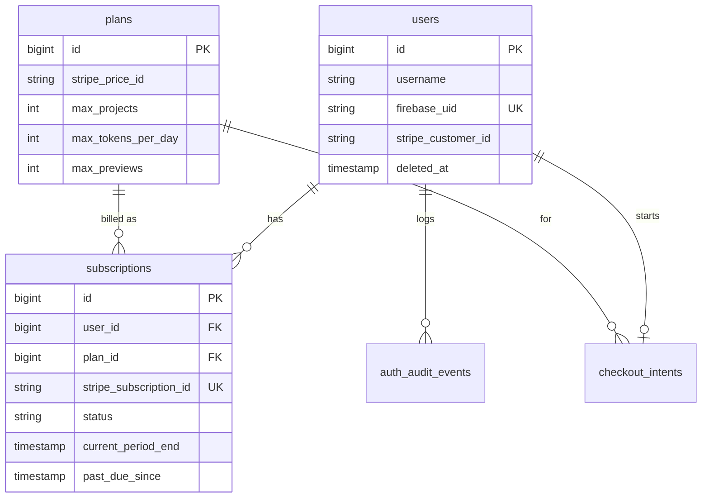
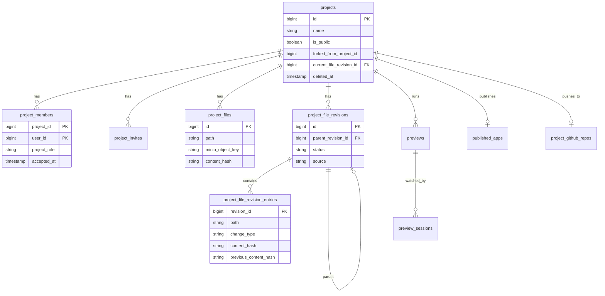
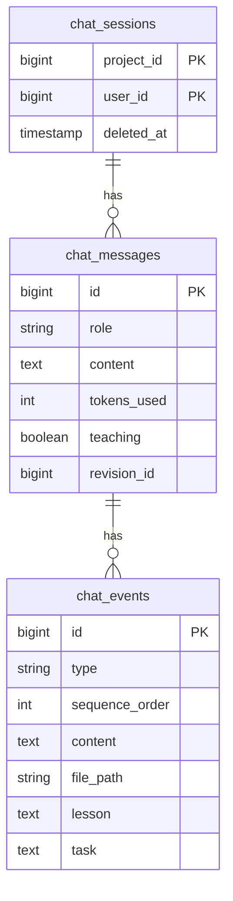

# Data model

Three Postgres databases, one per service. Flyway owns every schema and Hibernate only validates it. A reference into another service's database is a plain id with no foreign key (dashed lines below).

| Convention | |
|---|---|
| Schema changes | A new `V<n>__*.sql` migration. Never edit an applied one |
| Enums | `VARCHAR`, with no `CHECK` constraint, so adding a value needs no migration |
| Soft delete | Nullable `deleted_at` on users, projects and chat sessions. Every query filters it |
| Ownership | A `project_members` row with `project_role = OWNER`. Projects have no owner column |
| Upserts | Native `INSERT … ON CONFLICT` where a duplicate must be caught |

## account

`revoked_sessions` holds signed-out cookie hashes until they expire. `webhook_events` records each Stripe event id once, so a repeated delivery is ignored.

## workspace

| Table | Notes |
|---|---|
| `project_files` | Metadata only. Bytes live in MinIO at `{projectId}/{path}`, and blobs at `blob/<sha256>` |
| `project_file_revisions` | `STAGING` → `APPLIED`, `FAILED` or `CONFLICT`. Source is `AI_GENERATION`, `MANUAL_EDIT` or `RESTORE` |
| `previews` | One runner pod per project: pod name, status, synced revision, failure kind |
| `preview_sessions` | One per collaborator watching, so one person stopping doesn't kill it for everyone |
| `published_apps` | Slug, the live build prefix (`b<N>/`), and the in-progress build with its pod and heartbeat |
| `github_connections` | Encrypted GitHub token per user |

`project_members.user_id`, `project_invites` and `github_connections` point at account users by id.

## intelligence

| Table | Notes |
|---|---|
| `chat_events` | One thing a turn did: thought, message, step, file edit or delete, question, tool call, outcome |
| `usage_logs` | Tokens per user per day, checked on every AI call |
| `usage_events` | Append-only ledger for the usage page, written in the same transaction |
| `code_notes` | Private notes from code insight |
| `project_tours`, `glossary_entries` | Written once per person, on request |

Chat is per person per project: a collaborator has their own session.
