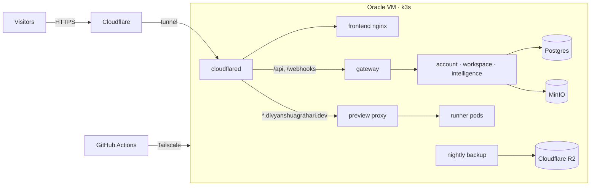
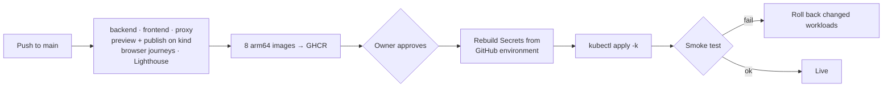

# Deployment

Production is one Oracle Always Free Arm VM (2 OCPU, 12 GB) running single-node k3s. No inbound ports are open.



| Namespace | Runs |
|---|---|
| `singularity` | cloudflared, frontend, gateway, discovery, account, workspace, intelligence, Postgres (10 GB), MinIO (20 GB), backup CronJob |
| `singularity-ai` | preview proxy, Redis, the runner pool and live previews (untrusted code) |

The app is at `singularity.divyanshuagrahari.dev`. Previews and published apps are at `*.divyanshuagrahari.dev`, one level down, because that's all Cloudflare's free wildcard certificate covers. Manifests are in `deploy/k8s/`: `base/`, plus the `oracle` and `kind` overlays.

## CI/CD



- Pull requests run the test jobs only. They never see a secret or deploy.
- Every Secret is rebuilt from the GitHub `production` environment on each deploy, so no secret lives only on the server.
- Before applying, the deploy records each workload's revision, so a rollback only touches what that deploy changed.
- Manual redeploy: run the workflow by hand with a commit SHA from `main`.

## Secrets

Kept in the GitHub `production` environment:

| | |
|---|---|
| Data | `DB_PASSWORD`, `MINIO_ROOT_PASSWORD`, `MINIO_RUNNER_SECRET`, `MINIO_PUBLISHED_SECRET` |
| App | `INTERNAL_SERVICE_SHARED_SECRET`, `PREVIEW_ACCESS_TOKEN_SECRET`, `FIREBASE_SERVICE_ACCOUNT_JSON`, `OPENROUTER_API_KEY` (a capped Gemini key) |
| Billing, GitHub | `STRIPE_*`, `GH_OAUTH_*` (optional) |
| Infra | `CLOUDFLARE_TUNNEL_CREDENTIALS`, `R2_*`, `TS_OAUTH_*`, `KUBE_API_SERVER`, `KUBE_DEPLOYER_TOKEN`, `KUBE_CA_CERT` |

To change the Postgres or MinIO password, change it on the server first, then update the Secret. Both only read the password when their volume is first created.

## Operations

```bash
kubectl -n singularity get pods
kubectl -n singularity-ai get pods -L status,project-id                # pool and live previews
kubectl -n singularity logs deploy/<name> --tail=100 -f
kubectl -n singularity rollout undo deploy/<name>
kubectl -n singularity-ai scale deployment/runner-pool --replicas=3    # demo day
kubectl -n singularity create job --from=cronjob/nightly-backup backup-now
```

| | |
|---|---|
| Monitoring | A scheduled GitHub workflow checks the site and the backup's age |
| Backups | 02:30 IST nightly: `pg_dump` of all three databases plus every MinIO bucket to R2, kept 7 days. `LATEST` is written last, only on success. Restore with `deploy/scripts/restore-backup.sh --context <ctx>` |
| Demo account | `DEMO_ENABLED=true` in production only. Rebuilt from scratch every day at 22:00 UTC |
| Upkeep | OS updates are automatic. k3s patches monthly: back up, then `curl -sfL https://get.k3s.io \| INSTALL_K3S_VERSION=<v> sh -` |
| Stripe live | Live prices and webhook secret in the Secrets, then drop `VITE_PAYMENTS_TEST_MODE` from the frontend build |

## Capacity

| | |
|---|---|
| Warm pool | 1 pod (about 300 Mi and 0.12 CPU while idle) |
| Preview pods | at most 7 (1 warm + 6 active) under the namespace quota |
| Idle preview | stopped after 10 min |
| Boot timeout | 4 min |
| Cost | about $0/month, plus a domain and a capped model key |

Everything is portable. To move hosts, restore the R2 backup onto any k3s cluster and point the tunnel at it.
